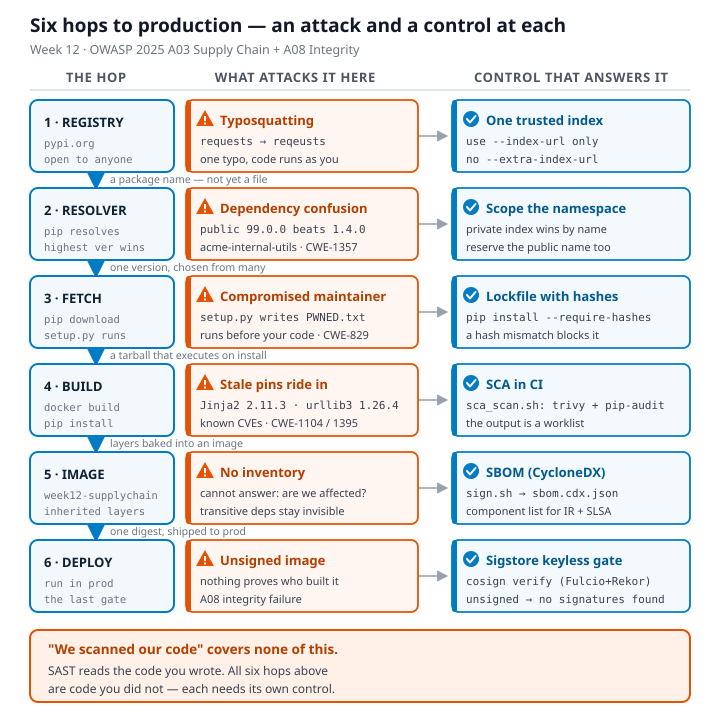

# Worksheet 12 — Software Supply-Chain Security (3 hrs)

> **Course:** Software Security (KOSEN69) · Week 12
> **Aligned:** OWASP 2025 — A03 Software Supply Chain Failures · A08 Software or Data Integrity Failures · **CWE:** CWE-1104, CWE-829, CWE-1357, CWE-1395
> **Signature game:** 📦 Dependency Confusion Heist
>
> **Ethics note:** This lab has **no live private/public registry to attack** — the dependency-confusion exercise is a controlled walkthrough (`dependency-confusion.md`) plus the interactive resolver simulation in Task 2, not a real package pull. **Never** plant or publish look-alike packages on the real PyPI or npm — that is an attack on every downstream user, and nothing in this lab requires it.

## Part 1 — Student Information

| Name | Student ID | Date | Group | AI Use |
|------|-----------|------|-------|
| Kay Khine Maw | 6631503060 | 22 Oct 2026 | - | Used ChatGpt for step-by-step guidance, explanations, and draft answers; I ran and checked the commands and corrected unsafe recommendations. |

## Part 2 — Lecture Questions

1. Explain **dependency confusion** (substitution). Why does a public `acme-internal-utils==99.0.0` win over a private `==1.4.0` when a resolver shops both indexes?

   Dependency confusion occurs when an attacker publishes a package with the same name as an internal dependency to a public registry. If the resolver searches both indexes and selects the highest matching version, public `acme-internal-utils==99.0.0` wins over the private `==1.4.0`, allowing the attacker’s package to be installed.

2. How does **typosquatting** (`reqeusts`, `urlib3`) achieve code execution *at install time* before any of your code runs?

   Typosquatting uses a package name that closely resembles a popular dependency, hoping a developer will mistype it or copy an incorrect name. Its setup or build hooks can run during installation, so malicious code executes before the application itself starts.

3. What is an **SBOM** (CycloneDX/SPDX) and why is it a prerequisite for both incident response and SLSA provenance?

   An SBOM is a machine-readable inventory of an artifact’s components, versions, licenses, and sometimes hashes, using formats such as CycloneDX or SPDX. Incident responders need it to identify affected dependencies quickly, while SLSA provenance uses the component inventory and build metadata to connect an artifact to its source and build process.

4. Sigstore **keyless** signing uses Fulcio (CA) + Rekor (transparency log) tied to an OIDC identity. Why is that safer than a long-lived private key (CWE-321)?

   Keyless signing issues short-lived certificates tied to an authenticated OIDC identity, so there is no long-lived private key to steal, copy, or forget to rotate. Fulcio verifies the identity and Rekor records the signing event publicly, making misuse easier to detect and reducing the impact of credential compromise.

5. Summarize the **SLSA** levels. Which level does "signed artifact + SBOM + provenance gate before deploy" put you at, and what is still missing?

   SLSA levels progress from basic build provenance and increasing source/build integrity to hardened, isolated, and reproducible builds with stronger protection against tampering. A signed artifact, SBOM, and provenance gate provide important verification controls but do not alone establish a specific SLSA level; they are closest to an early provenance-and-verification stage. Higher assurance still requires a tamper-resistant build service, authenticated source and dependencies, isolated builds, complete non-forgeable provenance, and often reproducibility.



---

## Part 3 — Hands-on Lab (150 min)

**Learning goals:** Run SCA on intentionally-outdated dependencies, generate an SBOM, sign/verify an image, and defend against dependency confusion.

**Prerequisites:** Docker; the lab folder (`requirements.txt`, `Dockerfile`, `app.py`, `sca_scan.sh`, `sign.sh`). For signing: browser for the OIDC flow + registry push access.

**Environment setup**
```bash
cd labs/week12-supply-chain
bash sca_scan.sh                 # trivy fs + pip-audit on requirements.txt (+ optional image scan)
docker build -t week12-supplychain:lab .
bash sign.sh week12-supplychain:lab   # CycloneDX SBOM -> sbom.cdx.json, then cosign sign + verify
```

**What to submit per task:** the exact command(s) + output, a screenshot, and a 2–3 sentence remediation note mapping the finding to A03/A08 or the CWE.

### Task 0 — Onboarding (15 min)
Read `requirements.txt` and list the pinned packages with their versions. Note why they are intentionally outdated (each is deliberately an old release so SCA tools flag its known CVEs).
**Deliverable:** the package/version table + which OWASP/CWE this maps to.

**Package/version table**

| Package | Version |
|---|---:|
| Flask | 1.1.4 |
| Werkzeug | 1.0.1 |
| Jinja2 | 2.11.3 |
| MarkupSafe | 2.0.1 |
| itsdangerous | 1.1.0 |
| click | 7.1.2 |
| requests | 2.25.1 |
| urllib3 | 1.26.4 |
| PyYAML | 5.4.1 |

**Mapping:** OWASP A03 — Software Supply Chain Failures; CWE-1104 and CWE-1395.


---

### Task 1 — SCA scan: build the remediation worklist (35 min)
**Goal:** Flag the known-vulnerable dependencies — A03.
**Steps:**
1. `bash sca_scan.sh` — read the `trivy fs` table (CVE, installed vs. fixed version) and the `pip-audit` advisory IDs (GHSA-/PYSEC-).
2. Pick three findings; record CVE/advisory id, severity, and the fixed version.
**Deliverable:** the SCA output + a 3-row remediation table (package → current → fixed).

The SCA scan found:

- Trivy: **11 HIGH vulnerabilities** and **0 CRITICAL vulnerabilities**
- pip-audit: **33 known vulnerabilities in 6 packages**

| Package | Current version | Advisory/CVE | Severity | Fixed version |
|---|---:|---|---|---:|
| Flask | 1.1.4 | CVE-2023-30861 | HIGH | 2.3.2 or 2.2.5 |
| Werkzeug | 1.0.1 | CVE-2023-25577 | HIGH | 2.2.3 |
| urllib3 | 1.26.4 | CVE-2021-33503 | HIGH | 1.26.5 |

**Remediation:** Upgrade the affected packages to fixed versions, regenerate the SBOM, and rerun Trivy and pip-audit before deployment.


---

### Task 2 — Dependency Confusion Heist (35 min)
**Goal:** Watch the wrong package win — A03 / CWE-1357.

**Reality check:** this lab does **not** stand up a live private/public registry. `acme-internal-utils` is
a worked example, not an installable package — there is nothing to actually `pip install` here (the name
doesn't exist on real PyPI either, so don't expect that to work as a shortcut). Task 2 is a controlled
walkthrough of the resolver's own rule, using the simulation below, which computes the real
"highest version wins" logic live instead of just asserting the outcome.

```sim
resolver-confusion
```

**Steps:**
1. Read `dependency-confusion.md`'s "Dependency confusion (substitution)" section for the mechanism.
2. In the simulation, load the **"the attack"** preset (private `1.4.0`, public `99.0.0`, merged /
   `--extra-index-url` mode) and record which index the resolver picks and why.
3. Keep the same version numbers and switch to the **single-index** (`--index-url`) mode; record how the
   verdict changes — this is the resolver behavior Task 4's "single trusted index" defense relies on.
4. Try the **"win the race"** preset (private version numerically higher than public) and note why the
   sim's own explanation calls that "not a defense."

**Deliverable:** a screenshot of the simulation's verdict in both index modes (merged vs. single) for the
same version pair, plus one sentence on why an attacker defeats the "keep my internal version number high"
idea.

**“the attack” preset**


**“single-index defense” preset**


**“win the race” preset**


With `--extra-index-url` in merged mode, the resolver installed `acme-internal-utils 99.0.0` from the public index because it selected the highest available version. With `--index-url` in single-index mode, it installed the private `1.4.0` package because the public index was not queried.

Keeping the internal version higher is not a reliable defense because an attacker can publish an even higher version; a single trusted index or hash-locked dependencies is stronger.

---

### Task 3 — SBOM + signing/verification (30 min)
**Goal:** Produce a component inventory and prove integrity — A08.
**Steps:**
1. After `bash sign.sh week12-supplychain:lab`, open `sbom.cdx.json` and find Flask's entry.
2. Read the `cosign verify` PASS for the signed image.
3. Negative test on an unsigned image (it **must** fail):
   `cosign verify --certificate-identity-regexp '.*' --certificate-oidc-issuer-regexp '.*' python:3.9-slim`
   → `Error: no signatures found`. (Both `--certificate-identity*` flags are required in keyless mode; without
   them cosign stops at `Error: --certificate-identity or --certificate-identity-regexp is required` — a usage
   error, which is *not* the same thing as proving the image is unsigned.)
**Deliverable:** the SBOM Flask component entry + the verify PASS + the negative-test failure.

- **SBOM:** Flask `1.1.4`
- **Cosign verify:** Not completed; Sigstore returned `Unregistered redirect_uri`.
- **Negative test:** `python:3.9-slim` failed with `Error: no signatures found`.


---

### Task 4 — Defend / fix it (35 min)
**Goal:** Stop dependency confusion and lock integrity — defenses from `dependency-confusion.md` + `sign.sh`.
**Steps:**
1. **Pin + hashes:** run `pip install --require-hashes -r requirements.txt` against this lab's own
   `requirements.txt` (it has no hashes yet) and record pip's refusal — `ERROR: Hashes are required in
   --require-hashes mode...` plus the `--hash=sha256:…` line pip prints for you. That refusal is the same
   mechanism that would block a real confusion substitution: once hashes are required, a package that
   doesn't match — from *either* index — cannot install silently.
2. **Single trusted index:** use one `--index-url` instead of `--extra-index-url`; explain why the resolver stops shopping around (tie this back to Task 2's single-index verdict).
3. **Namespace scoping:** describe reserving/namespacing the internal package name.
4. **Provenance gate:** state how the `cosign verify` from `sign.sh` becomes a gate before a simulated deploy.
**Deliverable:** the `--require-hashes` refusal output (step 1) + the simulation's before/after verdict for merged vs. single index (from Task 2) + the one defense you found most effective and why.

`pip install --require-hashes -r requirements.txt` failed with:

```text
ERROR: Hashes are required in --require-hashes mode
```

Merged mode selected public 99.0.0; single-index mode selected private 1.4.0. Hash-pinned dependencies are the strongest defense because substituted packages with incorrect hashes are rejected.

Use a trusted single index, reserve the internal package namespace, and require cosign verify to pass before deployment.


---

## Part 4 — Reflection

1. **Mapping:** table — finding | tool (`sca_scan.sh` / `sign.sh`) | OWASP 2025 id | CWE | fix.

| Finding | Tool | OWASP 2025 | CWE | Fix |
|---|---|---|---|---|
| Outdated vulnerable dependencies | `sca_scan.sh` | A03 — Software Supply Chain Failures | CWE-1104 — Use of Unmaintained Third-Party Components | Upgrade to supported versions and scan dependencies regularly. |
| Dependency confusion through a public package | `sca_scan.sh` | A03 — Software Supply Chain Failures | CWE-829 — Inclusion of Functionality from Untrusted Control Sphere | Use a single trusted index and reserve or namespace internal package names. |
| Unverified container provenance | `sign.sh` | A03 — Software Supply Chain Failures | CWE-345 — Insufficient Verification of Data Authenticity | Generate an SBOM, sign the image, and require `cosign verify` before deployment. |

2. **Real breach:** analyze the **XZ Utils backdoor (CVE-2024-3094)**. Which OWASP/CWE applies, and would an SBOM + signing + provenance gate have caught a maliciously-modified upstream dependency? (Compare with SolarWinds or Log4Shell if useful.)

The XZ Utils backdoor is a software supply-chain compromise in which malicious code was introduced into released upstream versions, so OWASP A03 and CWE-506 (Embedded Malicious Code) apply. An SBOM would have identified the affected version, while signing and provenance checks could have blocked an untrusted or unexpected build; however, these controls alone would not guarantee detection if the attacker controlled the legitimate release process and signing credentials.

3. **Best mitigation + SLSA self-assessment:** one paragraph — which SLSA level your defenses reach and why, and the single highest-leverage control for your team.

These defenses approach SLSA Build Level 2 because they use automated scanning, an SBOM, and planned signing and verification, but they do not yet demonstrate a fully hardened, independently verified build service. The highest-leverage control is a provenance gate that verifies signed artifacts and trusted build metadata before deployment, combined with hash-pinned dependencies.

---

## Grading rubric (100)

| Criterion | Weight |
|-----------|--------|
| Lecture questions (Part 2) | 20 |
| Exploitation + evidence (Tasks 1–3: SCA findings, confusion proof, SBOM/verify) | 40 |
| Defense (Task 4: pinning/hashes, single index, scoping, provenance gate) | 25 |
| Reflection (Part 4: mapping, XZ breach, SLSA self-assessment) | 15 |
| **Total** | **100** |

---

## Evidence & Integrity (required)

- **Identity proof:** every screenshot/diagram must show a terminal running `printf '%s | %s | ' "$(whoami)" '<YOUR-STUDENT-ID>'; date '+%F %T %Z'` **in the
  same image as the evidence**. When the evidence is a browser page, a DevTools panel or a
  rendered response, put that terminal **beside the browser and capture the whole screen** — a
  cropped window carries nothing that identifies you, and the lab's own output is
  byte-identical for the whole cohort *by design*, so the stamp is the only thing that makes
  the shot yours. Generic or borrowed evidence is not accepted.
- **Personalized flag (if this lab issues one):** ____________________
  *Flags are unique per student — submitting another student's flag is a violation. How to submit: **learn.zcr.ai/submit** (full guide: `SUBMISSION.md` in the repo root).*
- **Explain in your own words** *(graded on your reasoning, not copied text):*
  1. What did you do, and **why did the vulnerability work**?

  I scanned the intentionally outdated dependencies, reproduced dependency confusion by comparing the private and public package versions, and generated an image SBOM. The confusion worked because `--extra-index-url` merged both indexes and the resolver selected the attacker's higher public version without treating the private index as more trusted.

  2. **Why does your fix actually stop it** — and what could still break it?

  Hash-pinned requirements reject packages whose downloaded contents do not match the approved hashes, while a single trusted index prevents the resolver from considering the public look-alike. The protection could still fail if hashes or the trusted index are compromised, an internal name is accidentally exposed, signing keys or identity checks are misconfigured, or deployment skips the verification gate.

--- 

## 🤖 Audit the AI (required)

AI is a power tool you must **distrust** — you are graded on your *critique*, not the AI's answer.

1. Ask an AI assistant to exploit **or** fix this week's vulnerability. Paste its full answer.

**AI assistant answer:**

> Replace the old dependencies with their newest versions and keep using `--extra-index-url` so pip can find packages from both repositories. Then run `cosign verify IMAGE`; if it returns an error, continue the deployment because the image was already scanned by Trivy. This is sufficient because the SBOM lists the image contents and Trivy reports known vulnerabilities.

2. **Find what's wrong or risky** in it — insecure code, a subtly incomplete fix, a hallucinated API/function/CVE, a missed edge case, or wrong reasoning. Quote the exact line(s).

The answer is unsafe because it says to **“keep using `--extra-index-url`”** even though the simulation showed that merged indexes allow a higher public package to replace the private package. It also says to **“continue the deployment”** when `cosign verify` fails; that defeats the provenance gate. An SBOM and Trivy scan identify contents and known vulnerabilities, but they do not prove that an image came from an authorized builder or that it was not maliciously modified.

3. Produce the **correct, verified** version yourself and explain in 2–3 sentences why the AI's output was insufficient.

**Correct, verified version:**

Use one trusted `--index-url`, reserve or namespace internal package names, and install dependencies with approved hashes using `pip install --require-hashes -r requirements.txt`. Build an SBOM, sign the image, and stop deployment unless `cosign verify` succeeds with the expected certificate identity and OIDC issuer; the unsigned-image negative test produced `Error: no signatures found`, confirming that verification must block deployment. The AI answer was insufficient because it recommended the vulnerable merged-index configuration and treated a failed signature check as harmless.

> Disclose your AI use in the Part 1 table. This task counts toward your **Defense + Reflection** score.

---

## 🧠 Comprehension & Prompt (required)

**A. Explain in Plain English (EiPE).** In 2–3 sentences, in your own words, describe what this week's vulnerable code/endpoint actually *does* and *why it is exploitable* — explain the mechanism, don't dump jargon.

The lab builds and scans an application that installs deliberately outdated third-party packages, then simulates how a dependency resolver chooses between private and public packages. The vulnerability works because merged indexes treat both sources as one pool, so an attacker can publish a higher-version package with the same internal name and have it selected.

**B. Prompt Problem.** Write a **single prompt** that makes an AI produce a *correct, secure* fix for one finding. Run it: does the exploit now fail? If not, refine the prompt and try again. Submit the **final prompt + the verified result**.
*Graded on the prompt's precision and your verification — this trains problem decomposition and AI literacy (Denny et al. 2024).*

**Final prompt:**

> Analyze the dependency-confusion risk in this lab. Replace `--extra-index-url` with one trusted `--index-url`, recommend a reserved or namespaced internal package name, and require hashes for dependencies. Explain why each change prevents the public look-alike package from being selected, and include a verification test using the lab's resolver simulation.

**Verified result:** The simulation's merged mode installed public `acme-internal-utils` version `99.0.0` and reported **confused**. After switching to the single-index mode, it installed private version `1.4.0` and reported **safe**, so the dependency-confusion exploit failed in the defended configuration.

---