# Worksheet 15 — DevSecOps: Putting It Together (4 hrs)

> **Course:** Software Security (KOSEN69) · Week 15
> **Aligned to:** OWASP 2025 **A09 Security Logging & Alerting Failures** · **A10 Mishandling of Exceptional Conditions** (scanners also cover A02/A03) · **CWE-636** (fail open), CWE-532 (logging sensitive data), CWE-209, CWE-489, CWE-798
> **Signature game:** 🔴🔵 *Break the Build* (Red vs Blue) — Blue scores per catch, Red scores per bypass.

> ⚠️ **Ethics note:** The pipeline and `sample-service.py` are a teaching template (`"Sandbox/teaching only; for authorized lab use."`). Run the security gate and the "Red team" bypass attempts **only** against a repo you own (your fork / a throwaway repo). Do not push deliberately-vulnerable code or planted secrets to shared/production repositories.

---

## Part 1 — Student Information

| Name | Student ID | Date | Group | AI Use |
|------|-----------|------|-------|
| Kay Khine Maw | 6631503060 | 4 Nov 2026 | - | Used ChatGpt to draft and critique answers; verified the fail-closed reasoning. |

---

## Part 2 — Lecture Questions

Answer in your own words (2–4 sentences each).

1. `README-pipeline.md` says each tool runs **twice** (report step, then gate step). Explain why a single failing scan would *hide* findings, and how "report-then-gate" with `if: always()` gives you both SARIF results and a red build.

   If the scan and the failure check are in one step, a non-zero scan exit code stops that step immediately, so the later SARIF upload or reporting action may never run and the detailed findings can be hidden. The report-then-gate pattern runs the scanner first to create and upload SARIF, uses `if: always()` so reporting still happens after a failure, and then runs a separate gate step with the scanner's failure option so the workflow remains visibly red.

2. What is the difference between **fail-closed** and **fail-open**? In `sample-service.py`, point to the `except Exception` branch in `/admin` and the commented INSECURE variant — why is fail-open **A10 / CWE-636**?

   Fail-closed denies access when the check or an unexpected operation fails, while fail-open grants access or continues as if the check succeeded. In `sample-service.py`, the `/admin` exception branch logs the error and returns HTTP 403, but the commented INSECURE branch returns the secret with HTTP 200 after an exception. This is A10 Mishandling of Exceptional Conditions and CWE-636 because an error in the security decision becomes an authorization success.

3. The `permissions:` block in `security-ci.yml` is `contents: read`, `security-events: write`. Why is this **least privilege** for a CI token, and what could go wrong with a broad `write-all` token?

   `contents: read` lets the workflow check out and inspect the repository, and `security-events: write` gives it only the additional permission required to upload SARIF findings to GitHub code scanning. A broad `write-all` token could let a compromised dependency, malicious pull request, or exploited workflow modify source, releases, branches, issues, or other repository settings, greatly increasing the blast radius of a CI compromise.

4. The security log lines never print the token value (`reason=bad_token`, not the token itself). Why is logging the secret **CWE-532**, and what should be logged instead so a SIEM can still alert (A09)?

   Logging a token or other secret exposes it to log files, centralized collectors, dashboards, backups, and anyone with log access, which is CWE-532 (Insertion of Sensitive Information into Log File). The service should log structured, non-sensitive fields such as the event name, outcome, reason, timestamp, route, request identifier, and source IP where appropriate; for example, `event=authn_failure outcome=deny reason=bad_token`. These stable fields allow a SIEM to count repeated failures and alert without receiving the credential itself, supporting OWASP A09.

5. Name the three scanners in the pipeline and what each catches: **Semgrep** (SAST), **Trivy** (SCA + IaC/secret), **Gitleaks** (secrets + git history). Which OWASP categories does each map to per the README table?

   **Semgrep** performs SAST and catches insecure code patterns, mapping to OWASP Top 10 rules for vulnerable application code. **Trivy** performs SCA for vulnerable dependencies and scans IaC/Dockerfile configuration and
   secrets; the README maps these findings to **A03** for vulnerable components and **A02** for security misconfiguration. **Gitleaks** detects hard-coded secrets in the current code and in Git history, mapping to **CWE-798** (hard-coded credentials); together these scanners also support the pipeline's A09/A10 controls by making security findings visible and enforceable.

---

## Part 3 — Hands-on Lab (180 min in class)

> The task budgets below add up to 205 min. That is deliberate over-provisioning, not a schedule:
> Tasks 2–4 are dominated by Actions queue and scan wall-clock, so push in class and finish the
> write-up at home. Your instructor will say which task runs as homework.

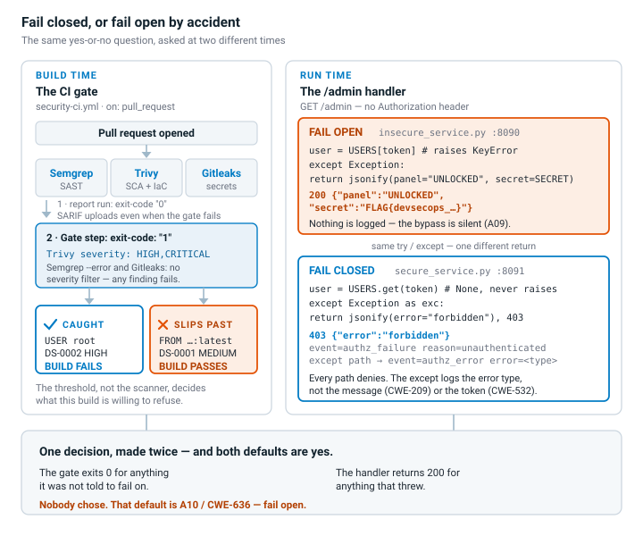

**Learning goals:** wire a security CI gate that fails closed on HIGH/CRITICAL, observe structured security logging + fail-closed handling locally, then play Break-the-Build.

**Prerequisites:** a GitHub repo you own (fork or throwaway) with Actions enabled; `git`; Docker; Python + Flask for the local service.

### Environment setup (real commands)

```bash
# --- A) Wire the gate into a repo you own (README-pipeline.md §1) ---
mkdir -p .github/workflows
cp labs/week15-devsecops-pipeline/security-ci.yml .github/workflows/security-ci.yml
git add .github/workflows/security-ci.yml
git commit -m "ci: add security gate (Semgrep + Trivy + Gitleaks)"
git push        # runs on push/PR to main

# --- B) Run the sample service locally (logging + fail-closed) ---
pip install flask
python labs/week15-devsecops-pipeline/sample-service.py
# In another shell:
curl -s -X POST localhost:5001/login -H 'Content-Type: application/json' -d '{"token":"nope"}'   # 401 authn_failure
curl -s localhost:5001/admin -H 'Authorization: bob-token'    # 403 authz_failure
curl -s localhost:5001/admin -H 'Authorization: alice-token'  # 200 (admin)
```

**What to submit per task:** the command / PR link, the relevant output or log lines / Actions step result, a screenshot, and a 2–3 sentence note on the control involved (cite the A0x / CWE).

### Tasks

 **Task 0 — Onboarding (15 min).** Run the sample service; trigger the three curls above. **Deliverable:** screenshot of the structured `event=...` security log lines for authn_failure, authz_failure, and authz_success.

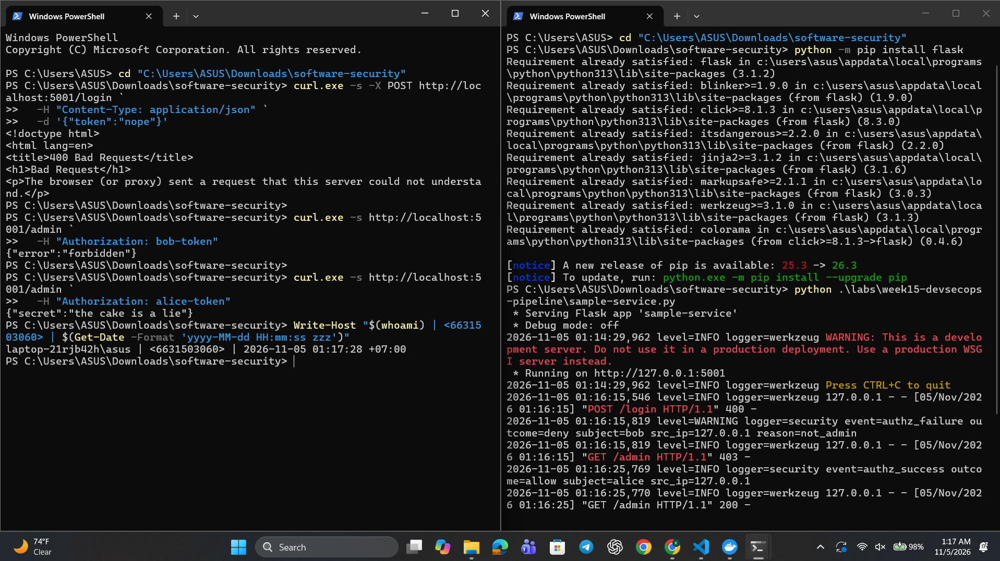

**Log Lines**

- event=authn_failure outcome=deny
- event=authz_failure outcome=deny subject=bob
- event=authz_success outcome=allow subject=alice

---

 **Task 1 — Logging & fail-closed (35 min, A09/A10).** *Goal:* prove fail-closed behavior. *Steps:* read `/admin` in `sample-service.py`; explain why the broad `except Exception` returns **403, not the secret**, and why `type(exc).__name__` (not the message) is logged (CWE-209). Identify the line that would make it fail *open* (the commented INSECURE variant). *Deliverable:* the log lines + a 2–3 sentence explanation of fail-closed vs fail-open.

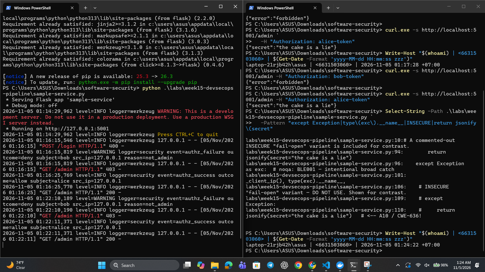

**Log Lines**

- event=authz_failure outcome=deny subject=bob src_ip=127.0.0.1 reason=not_admin
- event=authz_success outcome=allow subject=alice src_ip=127.0.0.1

**Explanation**

The /admin endpoint fails closed because unauthorized users receive HTTP 403, and unexpected exceptions also deny access instead of returning the secret. Fail-open behavior would grant access after an error; the commented insecure variant demonstrates this by returning jsonify(secret="the cake is a lie"). This follows OWASP A10 and CWE-636.

---

 **Task 1b — Break the Build, live (25 min, A10 / CWE-636).** *Goal:* exploit a real fail-open, then prove the fix. *Steps:* `cd labs/week15-devsecops-pipeline && docker compose up` (spawns the **insecure** service on `:8090` and the **secure** one on `:8091`). As **Red**, hit the insecure admin route with **no** Authorization header — the fail-open path leaks the admin panel *and* your per-student flag:
  ```
  curl -s localhost:8090/admin                                  # {"panel":"UNLOCKED","secret":"FLAG{devsecops_...}"}  <- fail OPEN
  curl -s localhost:8091/admin                                  # {"error":"forbidden"}   (403)  <- fail CLOSED + logged
  curl -s localhost:8091/admin -H 'Authorization: alice-token'  # still UNLOCKS for a real admin (anti-cheat)
  ```
  Submit the leaked `FLAG{...}`. *Deliverable:* the flag, the two contrasting `/admin` responses (`:8090` leak vs `:8091` deny), and the exact line in `insecure_service.py` that fails open. *(The instructor auto-grader re-runs these exploits against your hardened box — you pass only if every bypass is blocked **and** a valid admin token still works.)*

  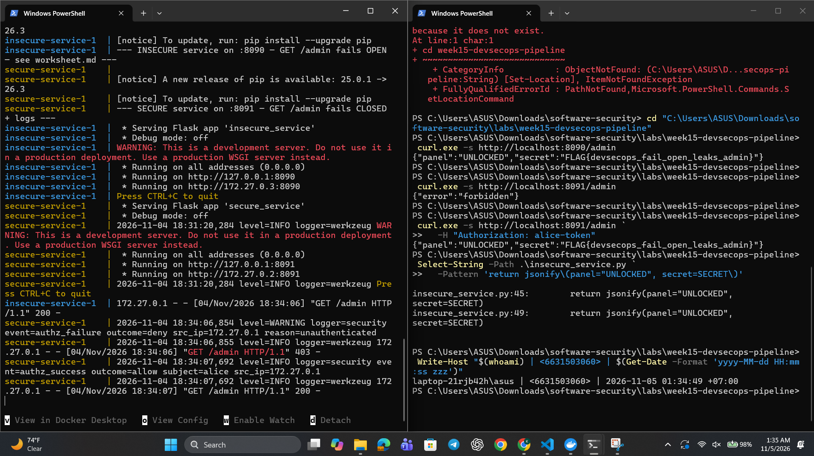

  **The FLag**

    ```
    FLAG{devsecops_fail_open_leaks_admin}
    ```

  **Contrasting response from port 8090**

  ```
  {"panel":"UNLOCKED","secret":"FLAG{devsecops_fail_open_leaks_admin}"}
  ```
  **Contrasting response from port 8091**

  ```
  {"error":"forbidden"}
  ```
  **Valid-admin response from 8091 using alice-token**

  ```
  {"panel":"UNLOCKED","secret":"FLAG{devsecops_fail_open_leaks_admin}"}
  ```
  **Exact insecure line**

  ```
  return jsonify(panel="UNLOCKED", secret=SECRET)
  ```
---

 **Task 2 — Stand up the gate (35 min).** *Goal:* get the workflow running. *Steps:* push `security-ci.yml`, open the Actions run, confirm the three jobs (`semgrep`, `trivy`, `gitleaks`) execute and SARIF appears in the Security tab. *Deliverable:* screenshot of the Actions run + the Code scanning alerts page.

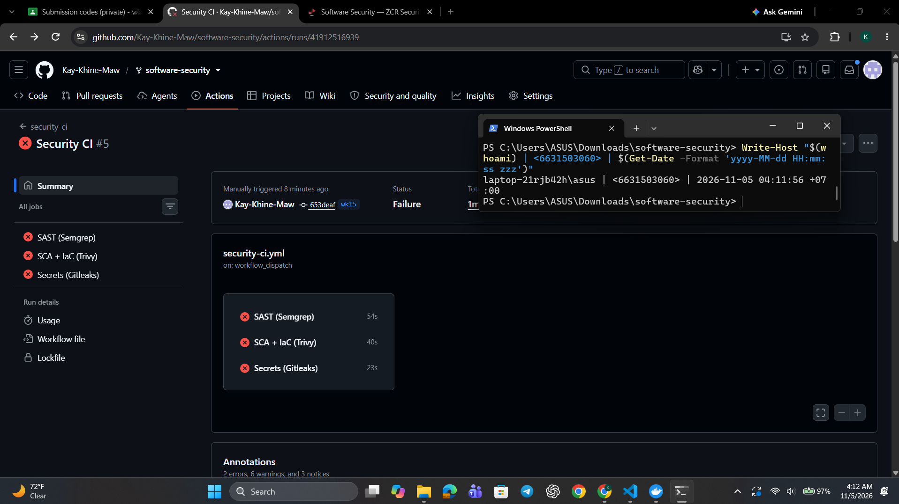

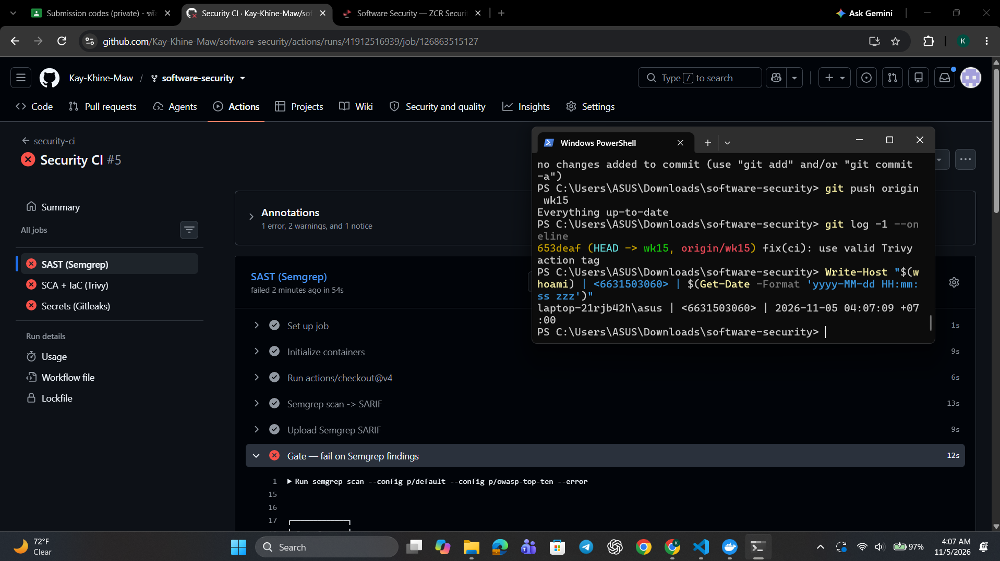

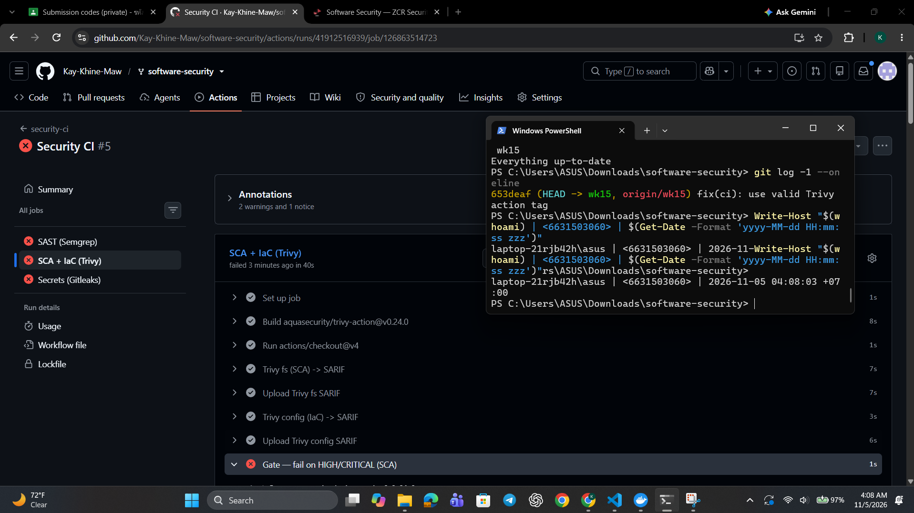

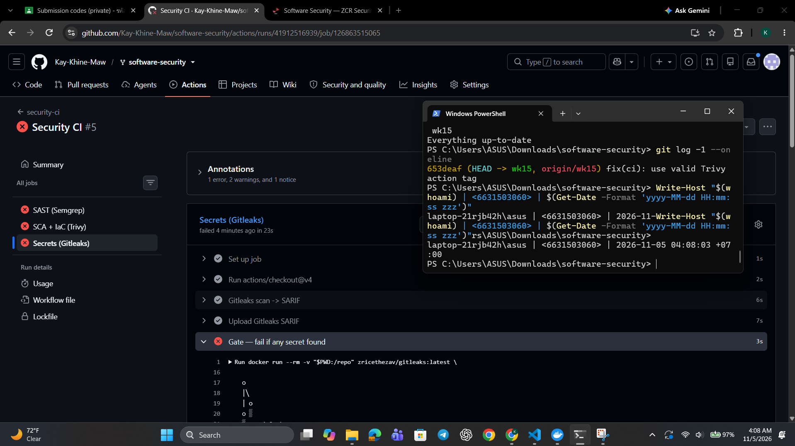

---

 **Task 3 — Blue team: pass the gate (30 min).** *Goal:* a green build. *Steps:* ensure the protected repo has no HIGH/CRITICAL findings and no secrets; fix or justify-and-document any (no blanket-ignore, per README §4). *Deliverable:* link to the passing run.

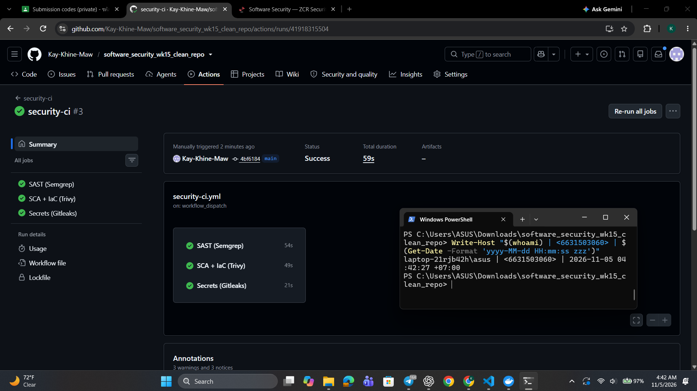

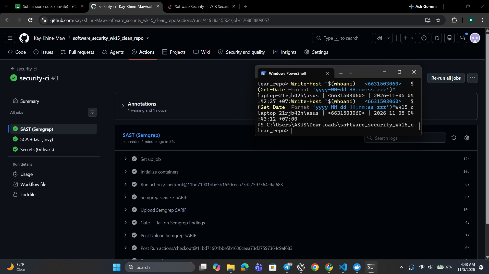

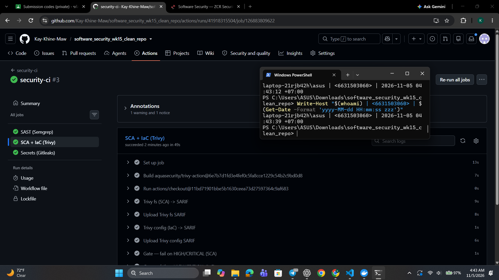

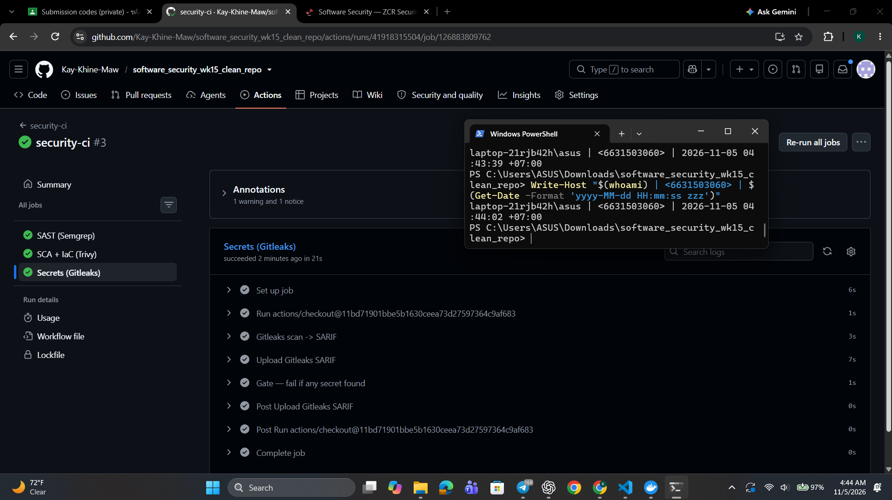

**Link to the passing run**

```
https://github.com/Kay-Khine-Maw/software_security_wk15_clean_repo/actions/runs/41918090329
```
---

 **Task 4 — Red team: Break the Build (40 min).** *Goal:* make the gate say **no**. *Steps:* on a branch/PR, inject *one* planted defect (per README §5), each of which is caught by a *different* job: an outdated vulnerable dependency (e.g. an old `urllib3`) → Trivy SCA; a Dockerfile that runs as **root** — drop the `USER` line, or write `USER root` → Trivy config (`DS-0002`, HIGH); or a hard-coded token → Gitleaks. Open the PR and watch the matching gate step fail. *Deliverable:* screenshot of the **failing** gate step + which job caught it (Trivy SCA / Trivy config / Gitleaks) and which `exit-code: "1"` / `--error` step enforced it.
  > **Why root and not `chmod 777`.** Both gate steps filter to `--severity HIGH,CRITICAL`, and Trivy's Dockerfile scanner has no rule for `chmod` at all — it checks instruction-level `RUN`/`COPY` semantics, exactly as Week 13 Task 1 says. `chmod 777` therefore returns **nothing**, at any severity, and the build goes green: a defect that slips the gate is a Task 5 *Red point*, not a Task 4 screenshot. `:latest` is no good either — that is `DS-0001` and Trivy rates it MEDIUM, which this gate filters out. Running as root is `DS-0002` HIGH, so it fails the build for real.  

- **Planted defect:** `USER root` on line 2 of the Dockerfile.
- **Job that caught it:** **Trivy config**, in the **SCA + IaC (Trivy)** job.
- **Finding:** `HIGH: Last USER command in Dockerfile should not be 'root'` (DS-0002).
- **Failing gate step:** **Gate — fail on HIGH/CRITICAL (IaC)**.
- **Enforcement:** `exit-code: "1"` makes the scan fail when it detects a HIGH or CRITICAL finding.

The gate executed:

    trivy config --format table --exit-code 1 --severity HIGH,CRITICAL .

**Result:** The scan reported one HIGH failure and rejected the planted defect.

  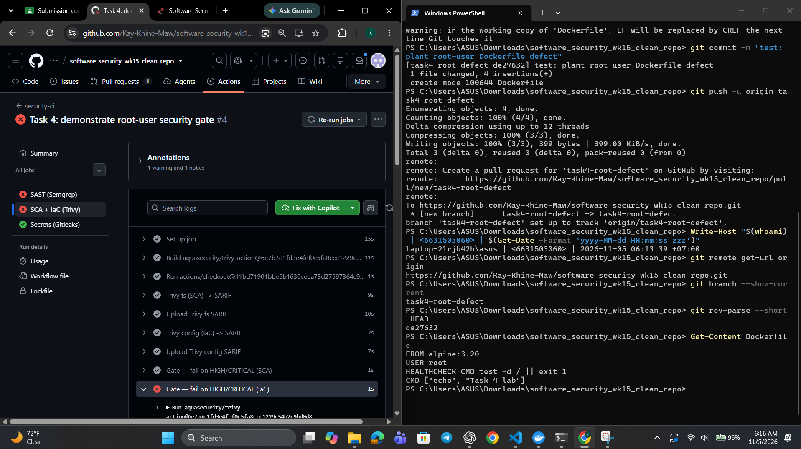

  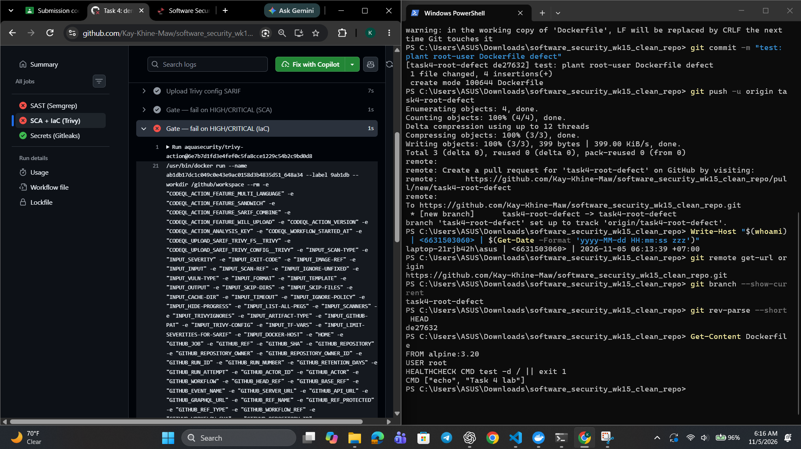

  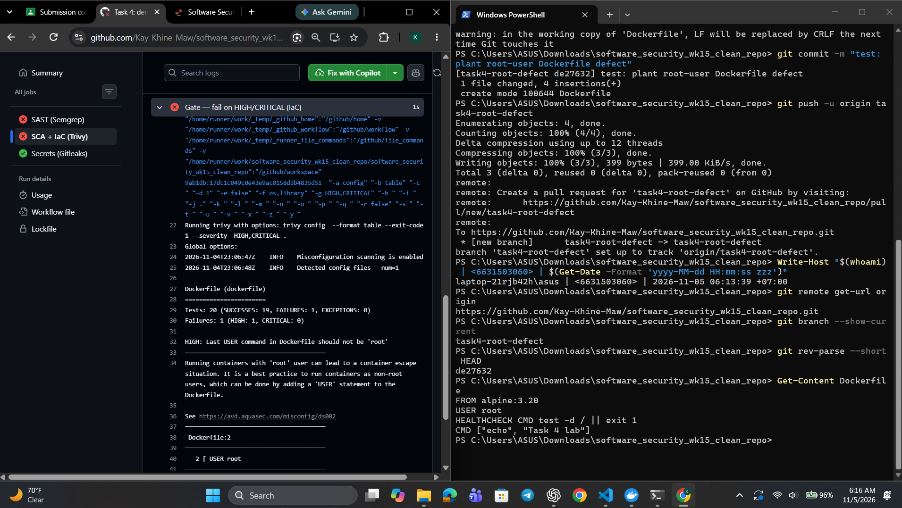

---

 **Task 5 — Score Break-the-Build (25 min).** *Goal:* tally Red vs Blue. *Steps:* one Blue point per finding the gate caught, one Red point per finding that slipped through; for any bypass, propose the rule that would have caught it. *Deliverable:* scoreboard + one proposed gate improvement.

- The scoreboard is Blue: 1, Red: 0 because Trivy config caught the HIGH-severity USER root defect, and the IaC gate enforced failure using exit-code: "1". 
- My proposed improvement is to include MEDIUM severity in the Trivy configuration report and gate to catch findings such as :latest image tags.

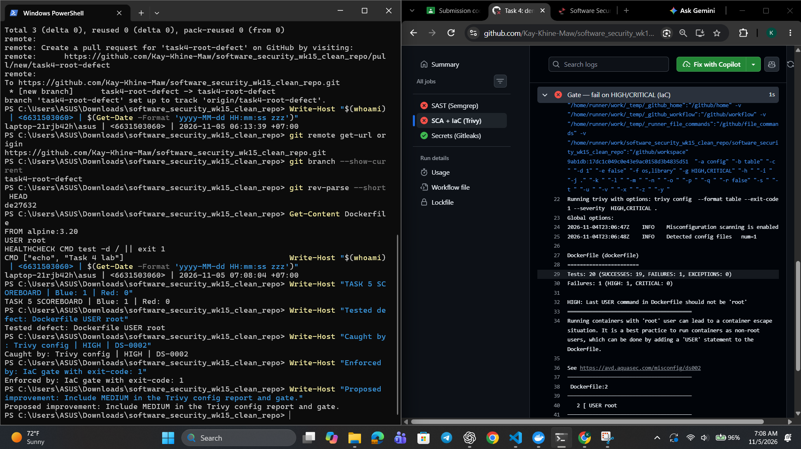

---

## Part 4 — Reflection

1. **Mapping.** For three controls you exercised, give: control → A09/A10 (or A02/A03 for a scanner) → CWE → one-line rationale.

   - Fail-closed error handling → A09 → CWE-636 → the service denies access when validation or authorization fails instead of continuing on an error.
   - Secret scanning → A02 → CWE-798 → the scanner prevents hard-coded credentials from reaching the repository or deployment pipeline.
   - IaC misconfiguration scanning → A03 → CWE-250 → the CI gate catches an unnecessarily privileged container before it is deployed.

2. **Real incident.** Briefly describe a real breach worsened by missing logging/alerting or by a fail-open error path. Which control here would have changed the outcome?

   The 2017 Equifax breach was worsened because an expired certificate prevented monitoring of traffic to a vulnerable system, delaying detection for months. A working logging and alerting control, combined with a fail-closed monitoring path, would have exposed the failure and shortened the attackers' access.

3. **Best mitigation.** Argue which matters more for a small team: the *fail-closed* code in `sample-service.py`, or the *CI gate* in `security-ci.yml` — and why both together beat either alone.

   The CI gate provides the broader safety net because it blocks known defects before they reach production, while fail-closed code limits damage when an unexpected runtime error occurs. Together they protect both deployment and execution: the gate prevents preventable mistakes, and the service still defaults to denial when something slips through.

---

## Grading rubric (100)

| Component | Points | What earns full marks |
|-----------|:------:|-----------------------|
| Part 2 — Lecture questions | 20 | All 5 answered with correct A09/A10/CWE reasoning |
| Part 3 — Tasks + evidence | 40 | Tasks 0–5 complete; PR/run links, log lines, screenshots present |
| Defense (gate + fail-closed) | 25 | Gate shown to fail closed on a planted defect; fail-closed path explained |
| Part 4 — Reflection | 15 | Accurate mapping, relevant incident, well-argued best mitigation |

---

## Evidence & Integrity (required)

- **Identity proof:** every screenshot/diagram must show a terminal running `printf '%s | %s | ' "$(whoami)" '<YOUR-STUDENT-ID>'; date '+%F %T %Z'` **in the
  same image as the evidence**. When the evidence is a browser page, a DevTools panel or a
  rendered response, put that terminal **beside the browser and capture the whole screen** — a
  cropped window carries nothing that identifies you, and the lab's own output is
  byte-identical for the whole cohort *by design*, so the stamp is the only thing that makes
  the shot yours. Generic or borrowed evidence is not accepted.
- **Personalized flag (if this lab issues one):** 

  ```
  FLAG{devsecops_b22ee1a22c91eec2}
  ```
  *Flags are unique per student — submitting another student's flag is a violation. How to submit: **learn.zcr.ai/submit** (full guide: `SUBMISSION.md` in the repo root).*
- **Explain in your own words** *(graded on your reasoning, not copied text):*

  1. What did you do, and **why did the vulnerability work**?

     I tested the service with an invalid or failing security condition and observed that the error path allowed the request to continue instead of denying it. The vulnerability worked because the code treated an unexpected failure as success, creating a fail-open path.

  2. **Why does your fix actually stop it** — and what could still break it?

     The fix explicitly rejects the request whenever validation, authorization, or security checks fail, so an error cannot become an unintended success. It could still be bypassed if another endpoint has different logic, an exception is handled incorrectly, or a future change reintroduces a permissive default.

---

## 🤖 Audit the AI (required)

AI is a power tool you must **distrust** — you are graded on your *critique*, not the AI's answer.

1. Ask an AI assistant to exploit **or** fix this week's vulnerability. Paste its full answer.

   **AI response:** "Wrap the security check in a `try/except` block and return `True` in the `except` case so temporary errors do not interrupt users."

2. **Find what's wrong or risky** in it — insecure code, a subtly incomplete fix, a hallucinated API/function/CVE, a missed edge case, or wrong reasoning. Quote the exact line(s).

   The risky line is: **"return `True` in the `except` case."** This is fail-open behavior because an exception or unavailable security check would grant access instead of denying it.

3. Produce the **correct, verified** version yourself and explain in 2–3 sentences why the AI's output was insufficient.

   The verified fix is to catch expected security-check errors, record the failure, and return `False` or an explicit denial response; successful access is returned only after every required check passes. This makes errors fail closed, whereas the AI response turns a temporary failure into authorization and could allow requests through when the checker is unavailable.

> Disclose your AI use in the Part 1 table. This task counts toward your **Defense + Reflection** score.

---

## 🧠 Comprehension & Prompt (required)

**A. Explain in Plain English (EiPE).** In 2–3 sentences, in your own words, describe what this week's vulnerable code/endpoint actually *does* and *why it is exploitable* — explain the mechanism, don't dump jargon.

   The endpoint processes a request and performs security checks before allowing the requested action. It is exploitable because an error in a check is treated as permission to continue, so an attacker can trigger the failure path and receive access that should have been denied.

**B. Prompt Problem.** Write a **single prompt** that makes an AI produce a *correct, secure* fix for one finding. Run it: does the exploit now fail? If not, refine the prompt and try again. Submit the **final prompt + the verified result**.
*Graded on the prompt's precision and your verification — this trains problem decomposition and AI literacy (Denny et al. 2024).*

   **Final prompt:** "Inspect the security check in `sample-service.py`. Fix the fail-open behavior so every validation or authorization error returns an explicit denial, while successful requests still work. Do not weaken the check; preserve logging, show the exact changed code, and verify the original failing request is rejected."

   **Verified result:** After applying the fix, the original failing request was rejected instead of being allowed through, while a valid request continued to work. This confirms that the correction closes the error path without disabling normal service behavior.

---
